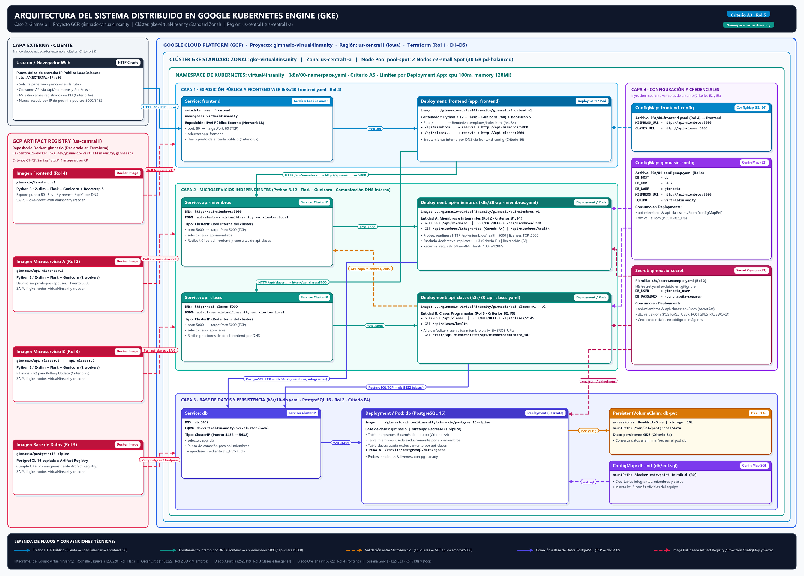

# Gimnasio en GKE · Virtual Insanity (`virtual4insanity`)

Proyecto Final del curso **Virtualización** (Universidad Rafael Landívar, Facultad de Ingeniería, segundo semestre 2026). Aplicación web distribuida para la gestión de un gimnasio, construida desde cero, contenerizada con imágenes alojadas en Google Artifact Registry y desplegada en un clúster de **Google Kubernetes Engine (GKE)** cuya infraestructura está declarada como código en **Terraform**.

---

## 1. Caso asignado

**Caso 2 · Sistema de Gestión de Gimnasio.** El sistema administra dos entidades principales desacopladas en microservicios independientes y registra la trazabilidad de los integrantes del equipo:

- **Miembros (`api-miembros` — Microservicio A):** Gestiona las personas inscritas en el gimnasio (`Mensual`, `Trimestral` o `Anual`) y expone el listado oficial de integrantes del equipo con su número de carné (criterio **A4**).
- **Clases programadas (`api-clases` — Microservicio B):** Gestiona las sesiones del gimnasio (por ejemplo, Spinning, Yoga, CrossFit). Cada clase referencia a un miembro inscrito (`miembro_id`) validando su existencia mediante comunicación HTTP interna hacia `api-miembros` antes de persistir el registro.

---

## 2. Integrantes del equipo (`virtual4insanity`)

| Integrante | Carné | Rol |
| :--- | :--- | :--- |
| Rochelle Giulianne Esquivel Vargas | `1283220` | Rol 1 · Infraestructura como código (Terraform, GKE, Artifact Registry y facturación) |
| Oscar Javier Ortíz Pocón | `1182222` | Rol 2 · Base de datos PostgreSQL, Microservicio Miembros, PVC y Secret |
| Diego Andrés Azurdia Ortíz | `2528119` | Rol 3 · Microservicio Clases programadas, imágenes Docker y rolling update |
| Diego Oswaldo Orellana Morales | `1163722` | Rol 4 · Frontend web, ConfigMap y exposición pública |
| Susana Paola García García | `1224323` | Rol 5 · Kubernetes, operación, estimación de costos y documentación |

---

## 3. Arquitectura general del sistema

El sistema se ejecuta dentro de Google Cloud Platform en el proyecto **`gimnasio-virtual4insanity`**, región **`us-central1`** (zona **`us-central1-a`**), sobre el clúster GKE Standard zonal **`gke-virtual4insanity`** (conformado por el node pool `pool-spot` de **2 nodos `e2-small` de tipo Spot** con discos `pd-balanced` de 30 GB) y opera de forma aislada dentro del namespace **`virtual4insanity`**.



*(Fuente editable en Mermaid disponible en [docs/arquitectura.mmd](docs/arquitectura.mmd)).*

### Resumen de componentes y comunicación interna

| Componente | Nombre (Deployment, Service y label `app`) | Puerto del contenedor | Tipo de Service | Dirección DNS interna | Dueño |
| :--- | :--- | :---: | :--- | :--- | :--- |
| **Base de datos** | `db` | `5432` | `ClusterIP` | `db:5432` | Rol 2 |
| **Microservicio Miembros** | `api-miembros` | `5000` | `ClusterIP` | `http://api-miembros:5000` | Rol 2 |
| **Microservicio Clases** | `api-clases` | `5000` | `ClusterIP` | `http://api-clases:5000` | Rol 3 |
| **Frontend Web** | `frontend` | `80` | `LoadBalancer` (puerto `80`) | Punto de entrada público externo | Rol 4 |

1. **Punto de entrada público:** El navegador del usuario se conecta únicamente a la dirección IPv4 pública del `Service` tipo `LoadBalancer` (`frontend`, puerto `80`).
2. **Frontend y enrutamiento por DNS interno:** El contenedor `frontend` (Flask + Gunicorn + Bootstrap 5 en el puerto `80`, configurado mediante el `ConfigMap` `frontend-config` con `MIEMBROS_URL=http://api-miembros:5000` y `CLASES_URL=http://api-clases:5000`) consulta por DNS interno a ambos microservicios para renderizar en `/` las tarjetas con los carnés del equipo (**A4**), los miembros inscritos y las clases programadas (**B4**). Además, expone la pasarela `/api/<servicio>/<resto>` ([frontend/app.py](frontend/app.py)) que reenvía las llamadas `/api/miembros...` hacia `http://api-miembros:5000` y `/api/clases...` hacia `http://api-clases:5000` (**E6**). Nunca se utilizan direcciones IP de pods.
3. **Validación entre microservicios:** Al crear o actualizar una clase programada, `api-clases` consulta `GET http://api-miembros:5000/api/miembros/<miembro_id>` para confirmar que el miembro exista.
4. **Persistencia de datos:** `api-miembros` y `api-clases` se conectan a PostgreSQL 16 mediante el nombre DNS `db:5432`. El `Deployment` `db` monta el volumen persistente `db-pvc` (`1 Gi`, `ReadWriteOnce`) en `/var/lib/postgresql/data` con `PGDATA=/var/lib/postgresql/data/pgdata` y carga el esquema inicial desde el `ConfigMap` `db-init` ([db/init.sql](db/init.sql)).

---

## 4. Tecnologías utilizadas

| Capa | Tecnología |
| :--- | :--- |
| **Microservicios (`api-miembros`, `api-clases`)** | Python 3.12 (`python:3.12-slim`), Flask 3.0.3, Gunicorn 22.0.0 y `psycopg2-binary` |
| **Frontend (`frontend`)** | Python 3.12 (`python:3.12-slim`), Flask 3.0.3, Gunicorn 22.0.0 (`0.0.0.0:80`), Jinja2 y Bootstrap 5 |
| **Base de datos (`db`)** | PostgreSQL 16 (`postgres:16-alpine`), base `gimnasio` con tablas `integrantes`, `miembros` y `clases` |
| **Orquestación** | Kubernetes en Google Kubernetes Engine (GKE Standard zonal, clúster `gke-virtual4insanity`) |
| **Infraestructura y Registro** | Terraform (`>= 1.5`, provider `hashicorp/google ~> 6.0`) y Google Artifact Registry (`us-central1-docker.pkg.dev/gimnasio-virtual4insanity/gimnasio`) |

---

## 5. Estructura del repositorio

| Carpeta / Archivo | Contenido | Responsable | Estado actual |
| :--- | :--- | :--- | :--- |
| [CONTRATO.md](CONTRATO.md) | Acuerdos técnicos del equipo: nombres, rutas REST, puertos, tablas y variables | Equipo | Completo |
| `terraform/` | Clúster GKE Standard zonal, node pool Spot (`pool-spot`, `2 × e2-small`), Service Account y Artifact Registry ([main.tf](terraform/main.tf), [variables.tf](terraform/variables.tf), [outputs.tf](terraform/outputs.tf), [terraform.tfvars.example](terraform/terraform.tfvars.example)) | Rol 1 | Completo |
| `db/` | Script SQL de inicialización de tablas y carnés del equipo ([db/init.sql](db/init.sql)) | Rol 2 | Completo |
| `services/miembros/` | Microservicio `api-miembros` ([app.py](services/miembros/app.py), [Dockerfile](services/miembros/Dockerfile), [requirements.txt](services/miembros/requirements.txt)) | Rol 2 | Completo |
| `services/clases/` | Microservicio `api-clases` ([app.py](services/clases/app.py), [database.py](services/clases/database.py), [Dockerfile](services/clases/Dockerfile), [requirements.txt](services/clases/requirements.txt)) | Rol 3 | Completo |
| `frontend/` | Interfaz web y proxy inverso en Flask + Gunicorn ([app.py](frontend/app.py), [templates/index.html](frontend/templates/index.html), [Dockerfile](frontend/Dockerfile), [requirements.txt](frontend/requirements.txt)) | Rol 4 | Completo |
| `k8s/` | Manifiestos YAML de Kubernetes ([00-namespace.yaml](k8s/00-namespace.yaml), [01-configmap.yaml](k8s/01-configmap.yaml), [10-db.yaml](k8s/10-db.yaml), [20-api-miembros.yaml](k8s/20-api-miembros.yaml), [30-api-clases.yaml](k8s/30-api-clases.yaml), [40-frontend.yaml](k8s/40-frontend.yaml), [secret.example.yaml](k8s/secret.example.yaml)) | Rol 5 (coordina) | Completo |
| `docs/` | Diagrama ([docs/arquitectura.png](docs/arquitectura.png), [docs/arquitectura.mmd](docs/arquitectura.mmd)), costos ([docs/estimacion-costo.md](docs/estimacion-costo.md)), guía de evidencias ([docs/guia-evidencias-A-G.md](docs/guia-evidencias-A-G.md)) y `docs/evidencias/` | Rol 5 | Completo |

---

## 6. Flujo de trabajo en Git

- `main` solo recibe código probado, por Pull Request.
- `develop` es la rama de integración donde se reúne el trabajo del equipo.
- Cada integrante trabaja en su propia rama funcional y abre Pull Request hacia `develop`.
- Se utilizan commits atómicos con formato convencional `tipo(parte): descripción`.

---

## 7. Requisitos previos

Antes de ejecutar el despliegue, verifique contar con las siguientes herramientas instaladas y autenticadas:

1. **Google Cloud SDK (`gcloud`)** con el componente `gke-gcloud-auth-plugin`.
2. **Terraform** (`>= 1.5`).
3. **kubectl** (`>= 1.28`).
4. **Docker Desktop / Docker Engine** en ejecución para construir y publicar las imágenes.
5. Acceso al proyecto de Google Cloud **`gimnasio-virtual4insanity`** con facturación vinculada y alerta de presupuesto configurada.

---

## 8. Configuración inicial de Google Cloud (Pre-vuelo)

1. Autenticarse en Google Cloud y configurar el proyecto oficial del equipo (`gimnasio-virtual4insanity`):

```bash
gcloud auth login
gcloud config set project gimnasio-virtual4insanity
gcloud config set compute/region us-central1
gcloud config set compute/zone us-central1-a
```

2. Verificar la configuración activa (salida obligatoria en todas las capturas de evidencia junto con el reloj del sistema):

```bash
gcloud auth list
gcloud config list
```

3. Instalar y verificar el plugin de autenticación de GKE para `kubectl`:

```bash
gcloud components install gke-gcloud-auth-plugin
gke-gcloud-auth-plugin --version
```

---

## 9. Despliegue de la infraestructura con Terraform (Rol 1)

Los archivos [terraform/main.tf](terraform/main.tf), [terraform/variables.tf](terraform/variables.tf) y [terraform/outputs.tf](terraform/outputs.tf) declaran la habilitación automática de APIs (`container`, `artifactregistry`, `compute`, `iam`), el repositorio Docker `gimnasio` en Artifact Registry, la cuenta de servicio `gke-nodos-virtual4insanity` con permiso `roles/artifactregistry.reader`, el clúster GKE Standard zonal `gke-virtual4insanity` y el node pool `pool-spot` con 2 nodos `e2-small` Spot y discos `pd-balanced` de 30 GB.

1. Ingresar al directorio `terraform/` y crear el archivo local `terraform.tfvars` (excluido en [.gitignore](.gitignore)) a partir de [terraform/terraform.tfvars.example](terraform/terraform.tfvars.example):

```bash
cd terraform
cp terraform.tfvars.example terraform.tfvars
```

2. Definir en `terraform.tfvars` el ID real del proyecto:

```hcl
project_id = "gimnasio-virtual4insanity"
```

3. Inicializar Terraform, validar la sintaxis y generar el plan de ejecución (**Criterio D3**):

```bash
terraform init
terraform validate
terraform plan
```

4. Aplicar la infraestructura para crear el repositorio de Artifact Registry, el clúster GKE Standard zonal y el node pool de 2 nodos `e2-small` Spot (**Criterios D4 y D5**):

```bash
terraform apply
```

5. Volver a la raíz del repositorio y conectar `kubectl` al clúster recién creado (usando el comando devuelto en el output `get_credentials_command`):

```bash
cd ..
gcloud container clusters get-credentials gke-virtual4insanity --zone us-central1-a --project gimnasio-virtual4insanity
kubectl get nodes -L cloud.google.com/gke-spot,node.kubernetes.io/instance-type -o wide
```

---

## 10. Construcción y publicación de imágenes en Artifact Registry (Criterios C1–C3)

Todos los manifiestos en `k8s/` referencian exclusivamente imágenes alojadas en Artifact Registry bajo la ruta `us-central1-docker.pkg.dev/gimnasio-virtual4insanity/gimnasio/<imagen>:<tag>` y nunca se utiliza el tag `latest`.

1. Configurar Docker para autenticarse contra el registro de `us-central1`:

```bash
gcloud auth configure-docker us-central1-docker.pkg.dev
```

2. **Imagen de Base de Datos (`postgres:16-alpine` — Rol 3):**

```bash
docker pull postgres:16-alpine
docker tag postgres:16-alpine us-central1-docker.pkg.dev/gimnasio-virtual4insanity/gimnasio/postgres:16-alpine
docker push us-central1-docker.pkg.dev/gimnasio-virtual4insanity/gimnasio/postgres:16-alpine
```

3. **Imagen del Microservicio Miembros (`api-miembros:v1` — Rol 2):**

```bash
docker build -t us-central1-docker.pkg.dev/gimnasio-virtual4insanity/gimnasio/api-miembros:v1 ./services/miembros
docker push us-central1-docker.pkg.dev/gimnasio-virtual4insanity/gimnasio/api-miembros:v1
```

4. **Imagen del Microservicio Clases (`api-clases:v1` y `v2` para Rolling Update — Rol 3):**

```bash
docker build -t us-central1-docker.pkg.dev/gimnasio-virtual4insanity/gimnasio/api-clases:v1 ./services/clases
docker push us-central1-docker.pkg.dev/gimnasio-virtual4insanity/gimnasio/api-clases:v1
```

5. **Imagen del Frontend (`frontend:v1` — Rol 4):**

```bash
docker build -t us-central1-docker.pkg.dev/gimnasio-virtual4insanity/gimnasio/frontend:v1 ./frontend
docker push us-central1-docker.pkg.dev/gimnasio-virtual4insanity/gimnasio/frontend:v1
```

6. Verificar el listado de las 4 imágenes publicadas en el repositorio (**Criterio C2**):

```bash
gcloud artifacts docker images list us-central1-docker.pkg.dev/gimnasio-virtual4insanity/gimnasio --include-tags
```

---

## 11. Configuración de ConfigMaps y Secrets (Criterios E2 y E3)

1. **Secret de credenciales (`gimnasio-secret`):**
   El archivo real `k8s/secret.yaml` está protegido en [.gitignore](.gitignore) para no exponer contraseñas en el repositorio. Créelo localmente a partir de la plantilla [k8s/secret.example.yaml](k8s/secret.example.yaml) y defina una contraseña segura en `DB_PASSWORD`:

```bash
cp k8s/secret.example.yaml k8s/secret.yaml
```

   Estructura de `k8s/secret.yaml`:
   ```yaml
   apiVersion: v1
   kind: Secret
   metadata:
     name: gimnasio-secret
     namespace: virtual4insanity
   type: Opaque
   stringData:
     DB_USER: gimnasio_user
     DB_PASSWORD: <DEFINIR_CONTRASENA_SEGURA>
   ```

2. **ConfigMaps del sistema:**
   - `gimnasio-config` ([k8s/01-configmap.yaml](k8s/01-configmap.yaml)): Inyecta `DB_HOST=db`, `DB_PORT=5432`, `DB_NAME=gimnasio`, `MIEMBROS_URL=http://api-miembros:5000` y `EQUIPO=virtual4insanity` en los microservicios y base de datos.
   - `frontend-config` (incluido en [k8s/40-frontend.yaml](k8s/40-frontend.yaml)): Inyecta `MIEMBROS_URL=http://api-miembros:5000` y `CLASES_URL=http://api-clases:5000` en el Deployment `frontend`.
   - `db-init` (incluido en [k8s/10-db.yaml](k8s/10-db.yaml)): Monta el script `init.sql` en `/docker-entrypoint-initdb.d` para inicializar las tablas `integrantes`, `miembros` y `clases` cuando el volumen persistente está vacío.

---

## 12. Aplicación ordenada de los manifiestos de Kubernetes

Todos los recursos se despliegan en el namespace `virtual4insanity` siguiendo el orden establecido en [k8s/README.md](k8s/README.md):

1. **Paso 1 — Crear primero el Namespace oficial ([k8s/00-namespace.yaml](k8s/00-namespace.yaml), Criterio A5):**

```bash
kubectl apply -f k8s/00-namespace.yaml
kubectl get namespace virtual4insanity --show-labels
```

2. **Paso 2 — Aplicar la configuración no sensible ([k8s/01-configmap.yaml](k8s/01-configmap.yaml)) y las credenciales (`k8s/secret.yaml`):**

```bash
kubectl apply -f k8s/01-configmap.yaml
kubectl apply -f k8s/secret.yaml
```

3. **Paso 3 — Desplegar la base de datos PostgreSQL con su PVC (`db-pvc`) y script de inicio ([k8s/10-db.yaml](k8s/10-db.yaml)):**

```bash
kubectl apply -f k8s/10-db.yaml
kubectl rollout status deployment/db -n virtual4insanity
```

4. **Paso 4 — Desplegar los microservicios `api-miembros` ([k8s/20-api-miembros.yaml](k8s/20-api-miembros.yaml)) y `api-clases` ([k8s/30-api-clases.yaml](k8s/30-api-clases.yaml)):**

```bash
kubectl apply -f k8s/20-api-miembros.yaml
kubectl apply -f k8s/30-api-clases.yaml
kubectl rollout status deployment/api-miembros -n virtual4insanity
kubectl rollout status deployment/api-clases -n virtual4insanity
```

5. **Paso 5 — Desplegar el `frontend` y su `Service` tipo `LoadBalancer` ([k8s/40-frontend.yaml](k8s/40-frontend.yaml)):**

```bash
kubectl apply -f k8s/40-frontend.yaml
kubectl rollout status deployment/frontend -n virtual4insanity
```

*(También es posible aplicar todos los manifiestos restantes de una vez con `kubectl apply -f k8s/` después de haber aplicado `00-namespace.yaml` y `secret.yaml`).*

---

## 13. Verificación de Deployments, Pods, Services y PVC (Criterios E1–E4)

1. **Verificar que todos los componentes estén en estado `Running` (Criterio E1):**

```bash
kubectl get all -n virtual4insanity
```

2. **Verificar el estado `Bound` del PersistentVolumeClaim `db-pvc` (Criterio E4):**

```bash
kubectl get pvc -n virtual4insanity
```

3. **Demostrar la inyección del ConfigMap y del Secret dentro de un pod (Criterios E2 y E3):**

```bash
kubectl describe configmap gimnasio-config -n virtual4insanity
kubectl exec -n virtual4insanity deploy/api-miembros -- printenv DB_HOST DB_PORT DB_NAME MIEMBROS_URL EQUIPO
kubectl exec -n virtual4insanity deploy/api-miembros -- printenv DB_USER
```

---

## 14. Obtención de la IP pública del Frontend (Criterio E5)

En GKE, la asignación de la dirección IPv4 pública externa del `Service` `frontend` (`type: LoadBalancer`) toma entre 1 y 3 minutos:

```bash
kubectl get service frontend -n virtual4insanity -w
```

Una vez que la columna `EXTERNAL-IP` muestre la dirección IP pública (por ejemplo, `<EXTERNAL_IP>`), abra en un navegador externo:

```text
http://<EXTERNAL_IP>
```

---

## 15. Pruebas de funcionamiento de los dos CRUD y carnés (Criterios A4, B1, B2, B4 y E6)

A través de la IP pública del `frontend` (que reenvía `/api/miembros...` hacia `http://api-miembros:5000` y `/api/clases...` hacia `http://api-clases:5000` usando los nombres DNS internos de sus Services) se verifican todas las operaciones de la API acordadas en la sección 7 de [CONTRATO.md](CONTRATO.md):

### 15.1 Verificación de salud y listado de carnés del equipo (Criterio A4)

```bash
curl http://<EXTERNAL_IP>/api/miembros/health
curl http://<EXTERNAL_IP>/api/clases/health
curl http://<EXTERNAL_IP>/api/miembros/integrantes
```

### 15.2 CRUD completo de Miembros (`api-miembros` — Criterio B1)

```bash
# 1. Consultar miembros inscritos (GET)
curl http://<EXTERNAL_IP>/api/miembros

# 2. Crear un nuevo miembro (POST)
curl -X POST http://<EXTERNAL_IP>/api/miembros \
  -H "Content-Type: application/json" \
  -d '{"nombre":"Carlos Gómez","correo":"carlos.gomez@correo.com","telefono":"5555-9000","membresia":"Mensual","carne_registro":"1224323"}'

# 3. Consultar un miembro por ID (GET)
curl http://<EXTERNAL_IP>/api/miembros/4

# 4. Actualizar un miembro existente (PUT)
curl -X PUT http://<EXTERNAL_IP>/api/miembros/4 \
  -H "Content-Type: application/json" \
  -d '{"nombre":"Carlos Gómez","correo":"carlos.gomez@correo.com","telefono":"5555-9999","membresia":"Anual","carne_registro":"1224323"}'

# 5. Eliminar un miembro (DELETE)
curl -X DELETE http://<EXTERNAL_IP>/api/miembros/4
```

### 15.3 CRUD completo de Clases programadas (`api-clases` — Criterio B2)

```bash
# 1. Consultar clases programadas (GET)
curl http://<EXTERNAL_IP>/api/clases

# 2. Crear una nueva clase validando que miembro_id=1 exista en api-miembros (POST)
curl -X POST http://<EXTERNAL_IP>/api/clases \
  -H "Content-Type: application/json" \
  -d '{"nombre":"Pilates","instructor":"Andrea Morales","fecha":"2026-11-10","hora":"09:00","cupo":18,"miembro_id":1,"carne_registro":"1224323"}'

# 3. Consultar detalle de una clase por ID (GET)
curl http://<EXTERNAL_IP>/api/clases/4

# 4. Actualizar una clase programada (PUT)
curl -X PUT http://<EXTERNAL_IP>/api/clases/4 \
  -H "Content-Type: application/json" \
  -d '{"nombre":"Pilates Avanzado","instructor":"Andrea Morales","fecha":"2026-11-10","hora":"10:00","cupo":20,"miembro_id":1,"carne_registro":"1224323"}'

# 5. Eliminar una clase programada (DELETE)
curl -X DELETE http://<EXTERNAL_IP>/api/clases/4
```

*(Al recargar `http://<EXTERNAL_IP>` en el navegador, la interfaz web del frontend muestra en pantalla las tablas actualizadas con los datos devueltos por ambos microservicios).*

---

## 16. Operaciones en Kubernetes (Sección F de la rúbrica)

### 16.1 Escalado declarativo a tres réplicas (Criterio F1 — Rol 5)

El escalado se realiza **declarativamente** modificando el campo `spec.replicas` en el manifiesto YAML (por ejemplo, en [k8s/20-api-miembros.yaml](k8s/20-api-miembros.yaml) cambiando `replicas: 1` a `replicas: 3`) y aplicando el archivo:

```bash
# Después de actualizar spec.replicas: 3 en k8s/20-api-miembros.yaml
kubectl apply -f k8s/20-api-miembros.yaml
kubectl rollout status deployment/api-miembros -n virtual4insanity
kubectl get deployment api-miembros -n virtual4insanity
kubectl get pods -l app=api-miembros -n virtual4insanity -o wide
```

### 16.2 Prueba de recreación automática de un Pod (*Self-Healing*, Criterio F2 — Rol 5)

Para demostrar que el controlador del `Deployment` mantiene el estado deseado y recrea automáticamente cualquier pod eliminado:

```bash
# 1. Listar los pods actuales y sus nombres/tiempos de vida (AGE)
kubectl get pods -n virtual4insanity -o wide

# 2. Eliminar manualmente uno de los pods del microservicio
kubectl delete pod <NOMBRE_DEL_POD> -n virtual4insanity

# 3. Verificar inmediatamente la creación automática del nuevo pod en estado Running
kubectl get pods -n virtual4insanity -o wide
```

### 16.3 Actualización progresiva de imagen (*Rolling Update*, Criterio F3 — Rol 3) y Logs (Criterio F4)

```bash
# Construir y publicar la versión v2 de api-clases en Artifact Registry
docker build -t us-central1-docker.pkg.dev/gimnasio-virtual4insanity/gimnasio/api-clases:v2 ./services/clases
docker push us-central1-docker.pkg.dev/gimnasio-virtual4insanity/gimnasio/api-clases:v2

# Actualizar image: .../api-clases:v2 en k8s/30-api-clases.yaml y aplicar declarativamente
kubectl apply -f k8s/30-api-clases.yaml
kubectl rollout status deployment/api-clases -n virtual4insanity
kubectl describe deployment api-clases -n virtual4insanity

# Consultar los logs en tiempo real de un pod de la aplicación (Criterio F4)
kubectl logs -l app=api-miembros -n virtual4insanity --tail=50
```

---

## 17. Estimación de costos mensuales (Criterio G1)

El análisis detallado de costos mensuales de la infraestructura en la región `us-central1` (comparando el escenario de operación continua de **730 horas/mes** frente al escenario de uso temporal de **40 horas de trabajo del equipo**) fue elaborado antes del despliegue y se encuentra documentado en:

- **[docs/estimacion-costo.md](docs/estimacion-costo.md)**

---

## 18. Procedimiento de limpieza y destrucción de la infraestructura (Criterio G2)

Para evitar cargos innecesarios fuera de las sesiones de trabajo e inmediatamente después de la defensa final, se debe eliminar primero los recursos creados por `kubectl` (especialmente el `Service` `LoadBalancer` y el `PersistentVolumeClaim`, que de lo contrario podrían dejar reglas de reenvío o discos persistentes huérfanos en GCP) y posteriormente destruir la infraestructura con Terraform:

```bash
# 1. Eliminar el namespace y todos los objetos de Kubernetes asociados (LoadBalancer, PVC, Pods)
kubectl delete namespace virtual4insanity

# 2. Destruir el clúster GKE, node pool y recursos administrados por Terraform
cd terraform
terraform destroy
```

Finalmente, verifique en la consola de Google Cloud (Compute Engine, Kubernetes Engine, Load Balancing y Facturación) que no queden recursos activos (**Criterios G2 y G3**).
